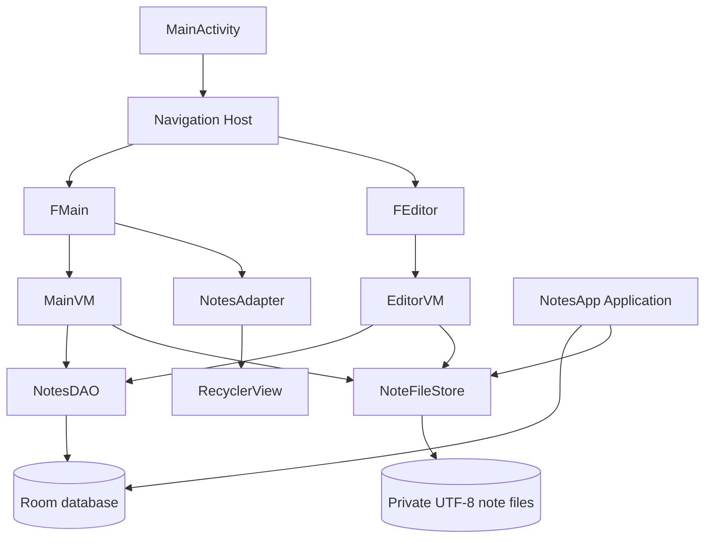

# Architecture

## 1. Product and runtime scope

SimpleNotes is a native Android application written in Kotlin. The current code provides a two-screen notes workflow: a list screen and an editor screen. It uses the Android Navigation Component to move between fragments, ViewModel and LiveData to expose asynchronous state, a RecyclerView adapter to render note titles, Room to persist note metadata, and app-private files to persist note bodies.

The database and note-body files are separate storage systems. Room records the title, a stable generated filename, and an auto-generated integer row ID. The note body is stored as UTF-8 text in the application's internal files directory. The filename is the stable identity passed between list and editor screens; the visible title is editable and is not used as a database key.

This is a local-first notes app. The repository does not implement cloud synchronization, user accounts, collaboration, encryption-at-rest, note search, attachments, or a remote API.

## 2. High-level component diagram

## 3. Application startup

1. Android creates the `NotesApp` Application object.
2. `NotesApp.onCreate()` stores the process-level application instance and builds the Room database named `notes`.
3. `MainActivity` inflates `AMainBinding`, installs the Material toolbar, and displays the navigation host from `main_graph.xml`.
4. The navigation graph opens `FMain`.
5. `FMain` configures a vertical `LinearLayoutManager`, a `NotesAdapter`, and the new-note floating action button.
6. `MainVM.load()` queries Room on an IO coroutine and publishes the resulting `List<Note>`.
7. The fragment selects either the RecyclerView or the empty-state view based on whether the returned list has entries.

## 4. Screen responsibilities

### Notes list

`FMain` owns view setup, navigation, popup menu presentation, and Android share chooser launching. It does not execute database queries or read note-body files directly. `MainVM` performs list, rename, delete, and share preparation work. `NotesAdapter` presents Room `Note` values and identifies each row by its filename.

### Editor

`FEditor` owns the text input and the toolbar menu. It reads its filename argument and asks `EditorVM` to load the record and body. The ViewModel runs Room and file access on `Dispatchers.IO`, then posts values to LiveData. Saving an existing note updates its file. Saving a new note writes a file and inserts the associated metadata record.

## 5. Stable identity and navigation

A note title is user-editable and can collide with another title. The current code therefore uses `Note.filename` as the stable identifier for lookups and navigation. The filename is generated by hashing a high-resolution time value with SHA-256. The current filename contract is 64 lowercase hexadecimal characters.

The `BUNDLE_FILE` key name is retained for compatibility with the existing navigation code, but the value now represents a filename rather than a title. The DAO lookup is by filename. The row title remains display-only metadata.

## 6. Persistence boundary

Room stores metadata in the app's private database. `NoteFileStore` stores each body in a separate file in `Context.filesDir`. The app does not use external/shared storage or request storage permissions.

The two stores cannot participate in a single Room transaction. New-note creation therefore performs file writing and metadata insertion in one IO coroutine and removes the just-created file if the database insert fails. Deletion removes the database row and then makes a best-effort deletion of its body file. A process crash between these operations can still leave an orphan file or a metadata row with a missing body. This is documented as a remaining consistency limitation.

## 7. Concurrency and lifecycle

ViewModels use `viewModelScope.launch(Dispatchers.IO)` for database and note-file operations. Fragments observe LiveData with `viewLifecycleOwner`, so observers are tied to the fragment view lifecycle. The adapter only receives metadata records and does not perform file I/O.

This avoids routine disk access in click callbacks and rendering. Long-running work is cancelled with its ViewModel scope when the ViewModel is cleared. The app does not currently expose progress state for individual file operations.

## 8. Android resources and UI

- `a_main.xml`: toolbar and Navigation host.
- `f_main.xml`: RecyclerView, empty state, and new-note FAB.
- `f_edit.xml`: multiline note editor.
- `i_note.xml`: Material card for one note title.
- `d_rename.xml`: reusable title input used for new-note naming and rename.
- `main_graph.xml`: list and editor destinations.
- `menu_edit.xml`: Save and Share actions.
- `menu_popup.xml`: Rename, Share, and Delete actions.
- `values/themes.xml` and `values-night/themes.xml`: light and dark Material 3 themes.

## 9. Production direction

Before adding cloud services, define identity and synchronization semantics, conflict resolution, encryption, export/import, retention, and recovery. The local storage design should remain independent from any future remote repository so that database and file access can be tested and replaced deliberately.
