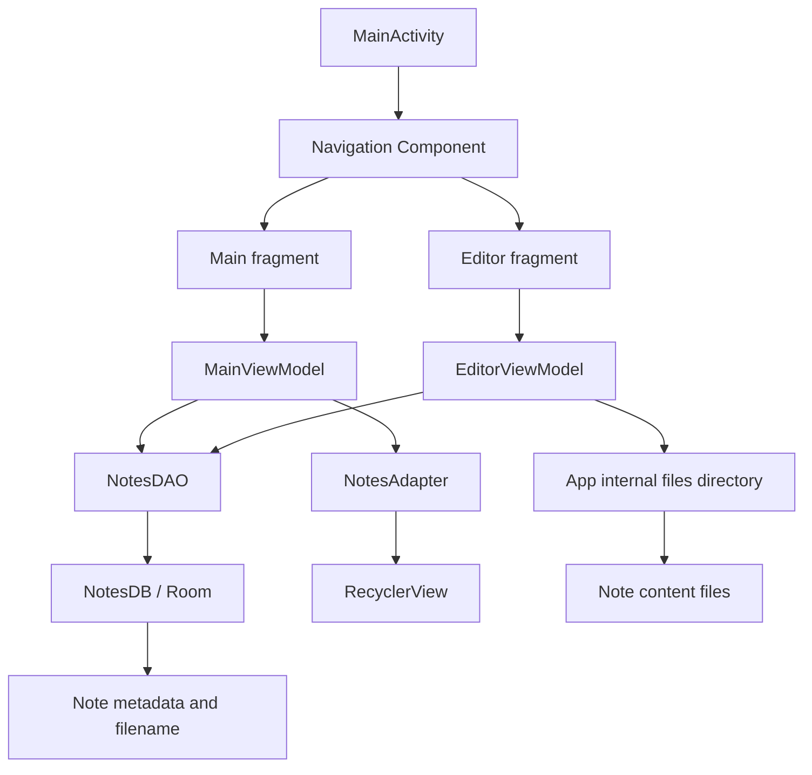

# Architecture

## Main components
- `MainActivity.kt`: hosts the navigation UI.
- `FMain.kt` and `MainVM.kt`: notes list and list state.
- `FEditor.kt` and `EditorVM.kt`: note editing and persistence behavior.
- `Note.kt`, `NotesDAO.kt`, and `NotesDB.kt`: Room persistence.
- `NotesAdapter.kt`: RecyclerView rendering and actions.
- `NotesApp.kt`: application-level setup and shared constants.

The current storage design separates note text files from Room metadata. Keep both sides consistent when renaming or deleting notes.
